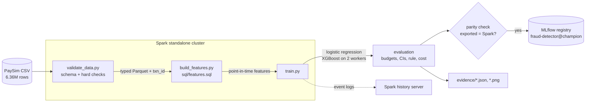

# Fraud detection on mobile-money transactions

Spark pipeline that validates 6.36 million mobile-money transactions, builds
leakage-free features in Spark SQL, trains logistic regression and distributed
XGBoost, and registers the better model in MLflow, evaluated the way a fraud
team works: by how much fraud it catches within a fixed alert budget.

Originally developed as part of my MSc Data Science at Coventry University, then extended into a standalone project.

## Results

Measured on the full dataset (6,362,620 transactions), on test hours the model
never saw during training or model selection. Full tables:
[`evidence/RESULTS.md`](evidence/RESULTS.md). Model card:
[`reports/model_card.md`](reports/model_card.md).

**If analysts can review 0.1% of transactions** (254 alerts over the 31
normal-volume test hours), the champion XGBoost model:

| | XGBoost (champion) | Logistic regression | Existing rule (`isFlaggedFraud`) |
|---|---:|---:|---:|
| Alerts | 254 | 254 | 1 |
| Share of alerts that are fraud (precision) | **61.8%** | 18.1% | 100% |
| Share of fraud cases caught (recall) | **40.7%** | 11.9% | 0.3% |
| Share of fraud **value** caught | **79.8%** | 30.4% | 0.7% |
| Average precision (95% CI) | **0.441 (0.395–0.493)** | 0.090 (0.065–0.121) | — |

The fraud rate in these hours is 0.152%, so random alerting would have a
precision of about 0.15%. The existing rule is perfectly precise but almost
never fires: 13 alerts in the whole 366-hour test period.


**What the numbers do and don't show**

| Check | Average precision | What it means |
|---|---:|---|
| Champion, as registered | 0.441 | the headline result |
| Same model **plus the balance columns** | 0.919 | the "near-perfect" score common in public PaySim notebooks comes from leaked columns, not from fraud behaviour |
| Same model **without time of day** | 0.166 | a large part of the score depends on PaySim generating fraud evenly across the day while legitimate activity follows a daily cycle |

Both checks are retrained on every run and logged to MLflow next to the champion.

**Reproducibility.** Two full runs gave identical results for the champion, the
baseline and the time-of-day check. Only the balance-column check moved, in
the third decimal (0.918 vs 0.919): it trains on a joined table whose row order
is not fixed, which changes XGBoost's row sampling.

## Architecture



| Component | Version | Role |
|---|---|---|
| Apache Spark | 3.5.9 (standalone: 1 master, 2 workers × 2 cores / 3 GB) | validation, Spark SQL features, distributed training |
| XGBoost | 2.1.4 (`xgboost.spark`) | gradient-boosted trees trained across the workers |
| MLflow | 3.17.0 | experiment tracking and model registry |
| DuckDB | 1.5.6 | exploratory SQL in the notebook, cross-checked against Spark |
| Docker Compose | — | the whole stack; nothing installed on the host |

## Quickstart

Requirements: Docker (8 GB of memory for the Docker VM), GNU make, and a Kaggle
account for the dataset.

```bash
# 1. Get the data: download https://www.kaggle.com/datasets/ealaxi/paysim1,
#    unzip, put the CSV in data/raw/  (or run `make data` with the Kaggle CLI set up)

make up         # build the image, start Spark + history server + MLflow
make run        # validate -> features -> train -> report (about 28 minutes on a 6-core laptop with an 8.7 GB Docker VM)
make eda        # execute notebooks/01_eda.ipynb against the data (about 1 minute)
make test       # 42 tests in the Spark image
make down       # stop; MLflow runs are kept in a Docker volume
```

| UI | URL |
|---|---|
| Spark master | http://localhost:8080 |
| Spark history (DAGs and stage timings of finished jobs) | http://localhost:18080 |
| MLflow (runs, metrics, registered model) | http://localhost:5000 |

No dataset? This creates a small PaySim-shaped file with a planted pattern,
enough to run the whole pipeline end to end (scores on it mean nothing):

```bash
docker compose run --rm --no-deps runner python3 scripts/make_synthetic_data.py data/raw/synthetic.csv
```

## Key design decisions

Each has a short decision record in [`docs/decisions/`](docs/decisions).

1. **Time-based split and point-in-time features**
   ([ADR 1](docs/decisions/0001-time-based-split-and-point-in-time-features.md)).
   The data is split by hour, never at random, and every feature window ends
   one hour *before* the transaction, so nothing is learned from the future.
2. **The balance columns are excluded**
   ([ADR 2](docs/decisions/0002-exclude-the-balance-columns.md)).
   They record how the simulator books an outcome, not how a fraudster behaves.
   The training job retrains with them anyway, to measure the inflation.
3. **Evaluation at alert budgets, with the test period split in two**
   ([ADR 3](docs/decisions/0003-evaluate-at-alert-budgets-and-segment-the-test-period.md)).
   A fraud team has fixed review capacity. And the last two weeks of PaySim have
   a much higher fraud rate, which would inflate a single test number.
4. **Only deployable models are registered, with a parity check**
   ([ADR 4](docs/decisions/0004-deployable-models-with-a-parity-check.md)).
   Both models score without Spark, and every run proves the exported model
   reproduces Spark's scores. This check caught a real bug: an XGBoost model
   exported with trees past its early-stopping point.

## How the model got here

The first full run is kept in
[`evidence/runs/01-initial-features/`](evidence/runs/01-initial-features).
Reviewing it led to three changes:

| Observation in run 1 | Change |
|---|---|
| `is_merchant_dest` had zero gain: scored transfers and cash-outs never go to merchants | removed |
| `orig_prior_txn_count` had 0.03% of total gain: origin accounts almost never repeat | removed |
| `hour_of_day` was the top feature, but the logistic baseline could only use it as a straight line (average precision 0.063) | hour also encoded on a 24-hour circle (`hour_sin`, `hour_cos`), and a check model **without** time of day added |

Average precision on the normal-volume test hours went from 0.063 to 0.090
for logistic regression and from 0.430 to 0.441 for XGBoost. The new check
showed how much of that comes from the simulated daily cycle (see Results).

## Project layout

```
sql/features.sql            feature definitions (Spark SQL window functions)
src/fraud/                  schema, validation, split, features, models, export, metrics
jobs/                       spark-submit entry points: validate, features, train
notebooks/01_eda.ipynb      exploratory analysis (DuckDB SQL), executed with outputs
tests/                      42 tests: hand-calculated metrics, feature timing, export parity
evidence/                   measured outputs: data profile, metrics, plots, RESULTS.md
docs/decisions/             architecture decision records
reports/model_card.md       intended use, performance, limitations
```

## Known limitations

- **Synthetic data.** PaySim is simulated. None of these numbers describe a real
  payment system.
- **Time of day is partly a simulator artefact.** Fraud is generated at a
  steady 144–221 cases for every hour of the day, while legitimate volume swings
  from 253 to 287,916 transactions. The model uses this heavily; without it,
  average precision falls from 0.441 to 0.166.
- **The test period changes character.** After hour 408 legitimate volume
  collapses while fraud continues, so test results are reported for the
  normal-volume hours and the low-volume tail separately.
- **Account ids don't link.** Only 3 of 4,097 fraudulent-transfer destinations
  ever cash out, so mule-network features are not possible with this data.
- **No fairness evaluation.** The data has no customer attributes.
- **Costs are not modelled.** A cost-minimising threshold is computed, but
  PaySim has no currency or review costs. With any assumed cost, "review most
  transactions" comes out optimal, so results are reported at fixed alert
  budgets instead ([details](evidence/RESULTS.md)).

## What I would do next

1. **Real-time scoring** of the registered champion with Kafka and Flink,
   with features computed incrementally and checked against the batch features,
   plus Grafana monitoring of alert rate and score drift.
2. **Delayed labels.** Track alert precision as fraud labels arrive days
   later, as they would in production.
3. **Run on Databricks**, swapping the local MLflow server for the managed one.
4. **A champion/challenger comparison** in shadow mode before promoting a new
   model version.
