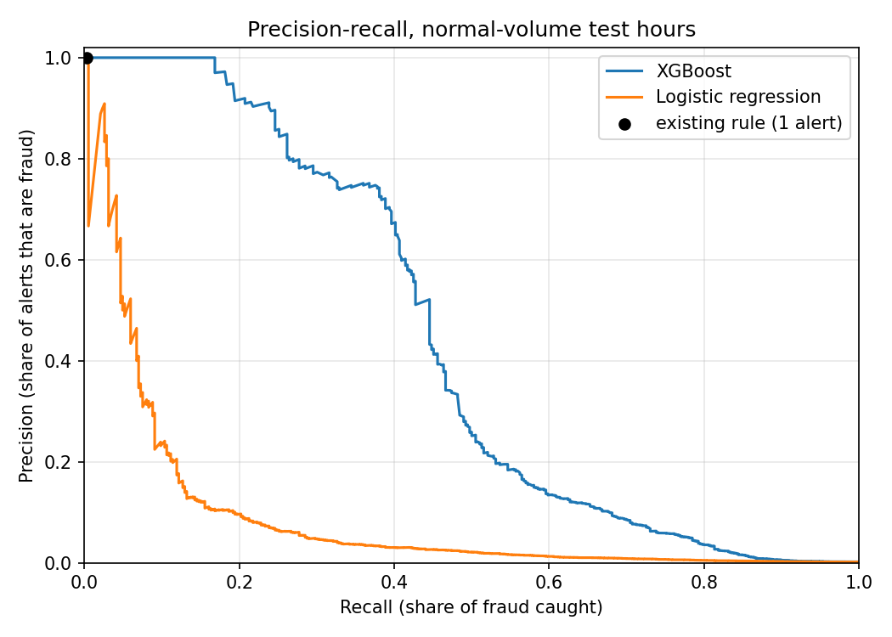
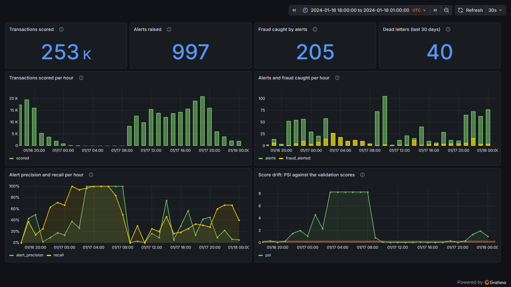
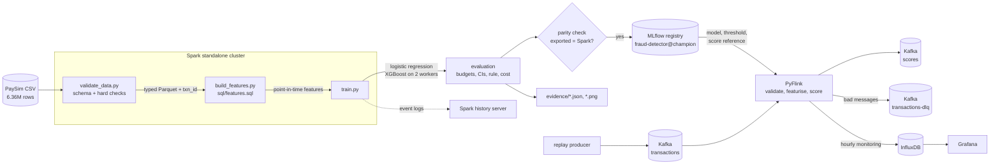

# Fraud detection on mobile-money transactions

Spark pipeline that validates 6.36 million mobile-money transactions, builds
leakage-free features in Spark SQL, trains logistic regression and distributed
XGBoost, and registers the better model in MLflow, evaluated the way a fraud
team works: by how much fraud it catches within a fixed alert budget.

The streaming design builds on a Kafka and Flink traffic-data pipeline I wrote for my MSc Big Data Analytics coursework at Coventry University. The fraud model, features, evaluation and real-time scoring are new work in this project.

## Results

Measured on the full dataset (6,362,620 transactions), on test hours the model
never saw during training or model selection. Full tables:
[`evidence/RESULTS.md`](evidence/RESULTS.md). Model card:
[`reports/model_card.md`](reports/model_card.md).

**If analysts can review 0.1% of transactions** (254 alerts over the 31
normal-volume test hours), the champion XGBoost model:

| | XGBoost (champion) | Logistic regression | Existing rule (`isFlaggedFraud`) |
|---|---:|---:|---:|
| Alerts | 254 | 254 | 1 |
| Share of alerts that are fraud (precision) | **61.8%** | 18.1% | 100% |
| Share of fraud cases caught (recall) | **40.7%** | 11.9% | 0.3% |
| Share of fraud **value** caught | **79.8%** | 30.4% | 0.7% |
| Average precision (95% CI) | **0.441 (0.395–0.493)** | 0.090 (0.065–0.121) | — |

The fraud rate in these hours is 0.152%, so random alerting would have a
precision of about 0.15%. The existing rule is perfectly precise but almost
never fires: 13 alerts in the whole 366-hour test period.



**What the numbers do and don't show**

| Check | Average precision | What it means |
|---|---:|---|
| Champion, as registered | 0.441 | the headline result |
| Same model **plus the balance columns** | 0.919 | the "near-perfect" score common in public PaySim notebooks comes from leaked columns, not from fraud behaviour |
| Same model **without time of day** | 0.166 | a large part of the score depends on PaySim generating fraud evenly across the day while legitimate activity follows a daily cycle |

Both checks are retrained on every run and logged to MLflow next to the champion.

**Reproducibility.** Two full runs gave identical results for the champion, the
baseline and the time-of-day check. Only the balance-column check moved, in
the third decimal (0.918 vs 0.919): it trains on a joined table whose row order
is not fixed, which changes XGBoost's row sampling.

## Real-time scoring

The registered champion also scores transactions as a stream: Kafka → PyFlink
→ `scores` topic, with hourly monitoring in InfluxDB and Grafana. The stream
replays the normal-volume test hours (with a 24-hour warm-up and a state
snapshot for older history), and an end-to-end check compares every streamed
result with the batch pipeline:

| Check | Result |
|---|---|
| Messages replayed | 959,016 transactions (all types, hours 354–408) + 284,974 account-history messages + 40 malformed |
| Transactions scored (TRANSFER and CASH_OUT, hours 378–408) | 253,490 of 253,490 expected; 0 missing, 0 unexpected, 0 duplicates |
| Largest difference, streamed vs batch feature | 3.0e-08 |
| Largest difference, streamed vs batch score | 0.0e+00 |
| Alerts raised (threshold 0.9478, model v3) | 997; 205 of 386 fraud cases caught |
| Malformed messages caught | 40 of 40, every reason matching what was injected |
| Run time (bounded replay, parallelism 3) | 26 min for 1,243,990 valid messages, about 806 a second |
| Verification | **passed** ([`evidence/streaming_verification.json`](evidence/streaming_verification.json)) |

The largest feature difference is in `dest_prior_amount` and is float rounding
from summing amounts in a different order; the scores themselves are
identical. The alerts use the threshold fixed on validation scores, which
flags 0.39% of these hours' transactions rather than the 0.5% budget it was
set for.



The drift panel shows what hourly monitoring on this data looks like. In the
overnight hours (03:00–08:00) only 10–28 transfers and cash-outs happen and
almost all of them are fraud, so every score lands in the top bin of the
validation distribution and the population stability index saturates near 8.3.
The shift is real, but it comes from too few transactions to act on. A
production alert on PSI would need a minimum hourly volume.

How the stream guarantees the same features as training
([ADR 5](docs/decisions/0005-streaming-features-must-equal-batch-features.md)):
messages are keyed by destination account, so one account's transactions
travel a single first-in first-out path (one Kafka partition, one source task,
one network channel) and arrive in hour order. Each is scored the moment it
arrives against the account's *earlier* hours only, with the current hour held
aside, which is the training SQL's "strictly earlier hours" rule. A test
checks this one-by-one path gives the same features as the Spark SQL.
Malformed messages are validated **before** event time is assigned, so they
can never move the watermark.

## Architecture



| Component | Version | Role |
|---|---|---|
| Apache Spark | 3.5.9 (standalone: 1 master, 2 workers × 2 cores / 3 GB) | validation, Spark SQL features, distributed training |
| XGBoost | 2.1.4 (`xgboost.spark`) | gradient-boosted trees trained across the workers |
| MLflow | 3.17.0 | experiment tracking and model registry |
| DuckDB | 1.5.6 | exploratory SQL in the notebook, cross-checked against Spark |
| Apache Kafka | 3.8.0 (KRaft) | transaction, score and dead-letter topics |
| Apache Flink | 1.20.5 (PyFlink) | stateful per-account scoring, event-time monitoring windows |
| InfluxDB / Grafana | 2.7.12 / 12.4.3 | hourly monitoring, dashboard provisioned as code |
| Docker Compose | — | the whole stack; nothing installed on the host |

## Quickstart

Requirements: Docker (8 GB of memory for the Docker VM), GNU make, and a Kaggle
account for the dataset.

```bash
# 1. Get the data: download https://www.kaggle.com/datasets/ealaxi/paysim1,
#    unzip, put the CSV in data/raw/  (or run `make data` with the Kaggle CLI set up)

make up         # build the image, start Spark + history server + MLflow
make run        # validate -> features -> train -> report (about 28 minutes on a 6-core laptop with an 8.7 GB Docker VM)
make eda        # execute notebooks/01_eda.ipynb against the data (about 2 minutes)
make test       # 74 tests in the Spark image
make down       # stop; MLflow runs are kept in a Docker volume
```

Then the stream (after `make run` has registered a champion):

```bash
make stream-data    # Spark: state snapshot + replay window (about 1 minute)
make stream-up      # stops Spark, starts Kafka, Flink, InfluxDB, Grafana
make stream-run     # empty the topics, replay into Kafka, score with Flink to the end (about 26 minutes on a laptop)
make stream-verify  # compare every streamed feature and score with the batch pipeline
```

The first `make` creates a `.env` with random InfluxDB and Grafana secrets
(gitignored); nothing usable is stored in the repository. All UIs are
published on localhost only.

On Linux, the containers write `data/` and `evidence/` as their own users
(`spark`, uid 185, and `flink`, uid 9999). Docker Desktop on Windows and macOS
maps this automatically. On a native Linux host, make those two folders
writable first, for example `chmod -R a+w data evidence`.

| UI | URL |
|---|---|
| Spark master | http://localhost:8080 |
| Spark history (DAGs and stage timings of finished jobs) | http://localhost:18080 |
| MLflow (runs, metrics, registered model) | http://localhost:5000 |
| Flink (job graph, checkpoints, `dead_letter_records` counter) | http://localhost:8081 |
| Grafana (monitoring dashboard, read-only without login) | http://localhost:3000 |

No dataset? This creates a small PaySim-shaped file with a planted pattern
(60,000 rows over hours 1–200), enough to run the whole pipeline end to end.
Scores on it mean nothing:

```bash
docker compose run --rm --no-deps runner python3 scripts/make_synthetic_data.py data/raw/synthetic.csv
```

Before running on it, set these in `.env`: `EVIDENCE_DIR=/app/output/evidence`
(gitignored, so the committed results are not overwritten), and
`SCORE_FROM_STEP=175` and `SCORE_TO_STEP=200` for the stream. Then use the same
`make` targets as above; the batch run takes about 3 minutes.

## Key design decisions

Each has a short decision record in [`docs/decisions/`](docs/decisions).

1. **Time-based split and point-in-time features**
   ([ADR 1](docs/decisions/0001-time-based-split-and-point-in-time-features.md)).
   The data is split by hour, never at random, and every feature window ends
   one hour *before* the transaction, so nothing is learned from the future.
2. **The balance columns are excluded**
   ([ADR 2](docs/decisions/0002-exclude-the-balance-columns.md)).
   They record how the simulator books an outcome, not how a fraudster behaves.
   The training job retrains with them anyway, to measure the inflation.
3. **Evaluation at alert budgets, with the test period split in two**
   ([ADR 3](docs/decisions/0003-evaluate-at-alert-budgets-and-segment-the-test-period.md)).
   A fraud team has fixed review capacity. And the last two weeks of PaySim have
   a much higher fraud rate, which would inflate a single test number.
4. **Only deployable models are registered, with a parity check**
   ([ADR 4](docs/decisions/0004-deployable-models-with-a-parity-check.md)).
   Both models score without Spark, and every run proves the exported model
   reproduces Spark's scores. This check caught a real bug: an XGBoost model
   exported with trees past its early-stopping point.

## How the model got here

The first full run is kept in
[`evidence/runs/01-initial-features/`](evidence/runs/01-initial-features).
Reviewing it led to three changes:

| Observation in run 1 | Change |
|---|---|
| `is_merchant_dest` had zero gain: scored transfers and cash-outs never go to merchants | removed |
| `orig_prior_txn_count` had 0.03% of total gain: origin accounts almost never repeat | removed |
| `hour_of_day` was the top feature, but the logistic baseline could only use it as a straight line (average precision 0.063) | hour also encoded on a 24-hour circle (`hour_sin`, `hour_cos`), and a check model **without** time of day added |

Average precision on the normal-volume test hours went from 0.063 to 0.090
for logistic regression and from 0.430 to 0.441 for XGBoost. The new check
showed how much of that comes from the simulated daily cycle (see Results).

## Project layout

```
sql/features.sql            feature definitions (Spark SQL window functions)
src/fraud/                  schema, validation, split, features, models, export, metrics,
                            streaming feature state, message checks, champion loader
jobs/                       spark-submit entry points: validate, features, train, stream state
streaming/                  Kafka replay producer, PyFlink scoring job, end-to-end verification
grafana/                    datasource and dashboard, provisioned as code
notebooks/01_eda.ipynb      exploratory analysis (DuckDB SQL), executed with outputs
tests/                      74 tests: hand-calculated metrics, feature timing, export parity,
                            streaming-vs-SQL feature parity, message validation
evidence/                   measured outputs: data profile, metrics, plots, verification, RESULTS.md
docs/decisions/             architecture decision records
reports/model_card.md       intended use, performance, limitations
```

## Known limitations

- **Synthetic data.** PaySim is simulated. None of these numbers describe a real
  payment system.
- **Time of day is partly a simulator artefact.** Fraud is generated at a
  steady 144–221 cases for every hour of the day, while the number of
  transfers and cash-outs per hour of the day swings from 253 to 287,916. The model uses this heavily; without it,
  average precision falls from 0.441 to 0.166.
- **The test period changes character.** After hour 408 legitimate volume
  collapses while fraud continues, so test results are reported for the
  normal-volume hours and the low-volume tail separately.
- **Account ids don't link.** Only 3 of 4,097 fraudulent-transfer destinations
  ever cash out, so mule-network features are not possible with this data.
- **No fairness evaluation.** The data has no customer attributes.
- **The validation hours do three jobs.** They drive XGBoost's early stopping,
  pick the champion and set the alert threshold. That favours XGBoost slightly
  in the model choice. The test hours are untouched by all three, so the
  reported results are not affected.
- **Costs are not modelled.** A cost-minimising threshold is computed, but
  PaySim has no currency or review costs. Because fraud amounts dwarf any
  assumed review cost, the cost-optimal threshold flags 83% of transactions at
  a cost of 10 per alert, 16% at 100 and still 2.4% at 1,000: 24 times the 0.1%
  budget above. So results are reported at fixed alert budgets instead
  ([details](evidence/RESULTS.md)).
- **Streaming throughput.** The PyFlink job processes about 800 records
  a second on this laptop: every record crosses between the JVM and a Python
  worker twice, and each in-scope transaction is scored with its own XGBoost
  call. That is enough for the replay, but production volumes would need
  batched scoring or the operator in Java.
- **Ordering is a hard requirement.** Scoring on arrival relies on one
  account's messages staying in hour order, which holds because the producer
  keys by account. If it did not, a record arriving after its account had moved
  on would be counted (`late_transactions`) and not scored, and the records
  that overtook it would already have been scored without it in their
  history. The end-to-end verification would show that as a feature mismatch.
- **Replaying old events through Kafka.** The replay's event timestamps are in
  2024, older than Kafka's default 7-day retention, which deleted the input
  as soon as it was written. The topics are created with `retention.ms=-1`.

## What I would do next

1. **Delayed labels.** Track alert precision as fraud labels arrive days
   later, as they would in production; the dashboard currently uses labels
   at scoring time.
2. **Run on Databricks**, swapping the local MLflow server for the managed one.
3. **A champion/challenger comparison** in shadow mode before promoting a new
   model version, with both models scoring the same stream.
4. **Throughput.** Score in micro-batches (PyFlink's Arrow-based vectorised
   functions, or the operator in Java with the booster loaded through
   XGBoost4J) and measure the gain.
